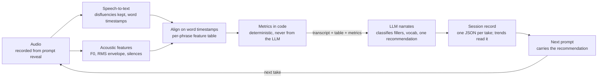

# SoundSmarter — Handoff

*As of 2026-11-05 · living document*

## Context

SoundSmarter is an app that records 30–60 seconds of extemporaneous speech, analyzes it, and returns metrics plus one recommendation. No code exists yet.

This file is the handoff for the coding agent implementing build 1. It fixes the product decisions, defines the metrics, and names the technical choices with their trade-offs. Items under **Decisions made** are settled. Items under **Open questions** are not — ask rather than pick. Provenance is marked throughout: what the product owner stated vs. what was proposed in design discussion and not yet confirmed.

**How this file is maintained.** This is the single source of truth; git history holds every version. Product decisions are made in design review and by the owner. The coding agent merges approved changes, builds, and never changes product decisions on its own. Anything it needs decided goes under **Questions for design** at the end.

## Target user

Build 1 targets young professionals, native English speakers, who speak under pressure: conversations with executives, interviews, presentations, moments when nerves show up as fillers and rushed starts. It is not for language learners.

- **Testers for build 1:** the owner and test user 1 (a young professional who gives presentations and gets nervous speaking).
- Filler words and prep time are the starting focus.

- Grammar correction and pronunciation/accent scoring are out of scope. Those features pull toward the ESL market (ELSA, Speak) and change the prompts, the feedback tone, and the technical stack.
- Nearest native-speaker comparables are public-speaking coaches like Yoodli and Orai. SoundSmarter's intended difference: short daily extemporaneous reps, filler-to-pause substitution as the core metric, trend tracking, and acoustic "music of speech" feedback that goes beyond transcript analysis.
- Objective mapping (dinner party vs. office vs. classroom) is deferred. Build 1 treats every user the same.

## Problem

Speakers rarely get measured feedback on how they speak, so they can't track improvement.

- Starting metrics: filler words, pauses, and prep time.
- The research behind speech metrics is still developing. Metrics will be added or revised as it does.

## Before / after

Sustained use should move a user from unaware to self-correcting on a handful of specific behaviors.

| Behavior | Before | After |
| --- | --- | --- |
| Crutch word | Doesn't know they have one | Knows the word and its rate; watches it fall across sessions |
| Fillers | Fills every gap with um / like / you know | Pauses instead; filler-to-pause ratio trends toward zero |
| Pace | Rushes, especially the first sentence | Speaking rate inside a conversational band; slows by pausing, not by dragging |
| Starting | Talks immediately, usually "so, um…" | Takes a beat; prep time is visible and treated as normal |
| Delivery | Monotone or trailing off, unaware of either | Hears where volume dropped or pitch flattened, on specific words |
| Feedback loop | None | One recommendation per take, carried into the next prompt; a trend line per metric |

## Roadmap (Builds 1–5)

Each build is due Monday at noon, New York time.

| Build | Class asks for | SoundSmarter |
| --- | --- | --- |
| **1 · Nov 9** — Intent + throwaway prototype | PRD v1, one local interaction | Prompt (fixed bank of 5) → record → transcribe (fillers kept) → filler count. Disposable is fine. |
| **2 · Nov 16** — Plan + smallest real local version + PostHog | Riskiest part, architecture, budget | Real stack (web + Python + SQLite); session records persisted; speaking rate + prep time (moved from build 1); pauses + filler-to-pause ratio; LLM classification of lexical fillers; PostHog installed. Start collecting and hand-labeling 10–15 takes (owner + pod member) for build 4 evals. Tests the top risk: filler detection accuracy. |
| **3 · Nov 23** — Build the core in small changes | The core product | Acoustic features (pitch, loudness); one recommendation per take carried into the next prompt; trends within prompt type. |
| **4 · Nov 30** — Test: domain evals or user replays | Evidence it works | Evals: hand-labeled recordings (collected from build 2) vs. app counts for fillers and pauses; tester sessions. |
| **5 · Dec 7** — Ship | Live URL + 2-minute video | Cloud deploy; crutch word and vocabulary features if time allows. |

### Build 1 detail (due Nov 9)

A throwaway prototype: the smallest working interaction.

0. **Intro screen.** Before Start, show (owner-written, verbatim): "SoundSmarter listens to you talk!" then: 1. Click Start. A prompt appears and recording begins right away. 2. Start answering immediately, in a natural, full voice. 3. Be specific with your answers. It helps the quality of feedback! 4. You can stop after 30 seconds, or keep going until the 60-second limit. Do not tell the user that fillers are counted.
1. **Prompt.** Show one prompt from a fixed bank of 5 (hard-coded; owner-written, listed below). If the user doesn't like it, they can skip to the next prompt in the bank (cycling back to the first after the fifth). Skipping discards the current recording and starts a fresh one with the new prompt.
2. **Record.** Recording starts at prompt reveal. Stop is greyed out (no countdown label) until 30 s, then the user can stop; hard stop at 60 s. Skip works at any time.
3. **Transcribe.** Deepgram (Nova-2, English) with `filler_words=true` and word-level timestamps. Build 1 is built to Deepgram.
4. **Show the filler count:** "uh" and "um" only, as detected by Deepgram, as a total plus a breakdown (e.g. "um ×4, uh ×2").

**Build 1 prompt bank** (owner-written or owner-approved, 2026-11-05, revised 2026-11-09; use verbatim; mix of two- and three-beat is fine for build 1; shown in random order):

1. Which social media platform do you like most, and why? Which do you like the least?
2. Tell me about the best Halloween costume you ever wore. What did you dress as most recently?
3. What would you do on your ideal day off? It could even be your birthday if you want to have a party.
4. Who was your first favorite musician or band? What did you love about them? Who are you listening to these days?
5. What do you remember about meeting your oldest friend for the first time? What do you remember from the last time you spent time with them?
6. What TV or movie character would your friends say you most closely resemble? If you could choose one TV or movie character to hang out with, who would it be?
7. If Olympic medals were given out for anything, what 'sport' would you medal in? Eating pizza? Making up funny lyrics to popular songs? Building with AI? What actual Olympic sport would you want to compete in?
8. What’s the farthest from home you’ve ever been? What do you remember most clearly about the first day there?
9. Describe the house or apartment you grew up in. If you could walk through it right now, which room would you go to first, and why that one?
10. If you had to live in one season for the rest of your life, which one? What would you miss most from the other three?
11. Explain something you’re weirdly good at: a party trick, a shortcut, a household fix. How did you get good at it, and how would you teach it?
12. Describe a tradition your family or friends have that would sound strange to an outsider. How did it start?

*Changed 2026-11-09 by the owner:* shared online demo pulled forward from build 5 for the Nov 10 demo: invite-code links, 3 takes per code, 30 takes per day across all codes, "N takes left" shown. Prompt bank grown from 5 to 12 and shown in random order (5 → 12: 3 owner-written, 5 proposed in Claude Cowork and owner-approved). Dropped "If you could learn any skill overnight…": hard to answer, lacks specificity. Live at https://soundsmarter-demo.onrender.com/ (Render free tier; ~30 s cold start).

*Changed 2026-11-08 by the owner:* added the intro screen and 30 s minimum after test user 1 didn't know what to do on the first screen. Target user broadened from MBA students to young professionals; test user 1 replaces the pod member.

*Changed 2026-11-07 by the owner:* build 1 counts only "uh" and "um" as detected by Deepgram. Deepgram also flags yes/no sounds (mhmm, mm-mm, uh-uh, uh-huh, nuh-uh); these are not counted. Nothing else (no "er", "like", "you know"); scope follows what the tool reliably does.

*Changed 2026-11-05 by the owner:* speaking rate and prep time moved to build 2 to keep build 1 focused on the riskiest assumption, filler detection.

**Prep time** (build 2) = prompt reveal → first spoken word, measured after the fact from the transcript's first word timestamp. Shown neutrally ("you took 1.4 s"), never as a score.

Not in build 1: speaking rate, prep time, prompt generation (beyond the fixed bank), acoustic features, LLM classification of lexical fillers, the recommendation, trends, persistence across sessions, the iterate loop.

## The finished loop (complete by build 3)

The product is the loop and nothing else: **prompt → record → listen → analyze → metrics → recommendation → iterate.**

1. **Prompt.** Show one prompt with structure built in — three beats, e.g. "Tell me about your last weekend: where you were, one thing that happened, how you felt about it." Each prompt is tagged by type (narrative, opinion, explanation). If the previous take produced a recommendation, the prompt states it as this take's focus.
2. **Record.** Recording starts when the prompt is revealed. The clock starts at the first detected word. Progress is a soft fill bar with no numerals; hard stop at 60 s; the user may stop early.
3. **Listen.** Play the take back. The user hears themselves before seeing numbers.
4. **Analyze.** Speech-to-text with disfluencies preserved and word-level timestamps, in parallel with acoustic feature extraction from the raw audio. Align the two on timestamps.
5. **Metrics.** Compute the Metrics spec deterministically in code. Show per-take values and the trend across prior takes of the same prompt type.
6. **Recommendation.** One LLM call sees the transcript, the per-phrase feature table, and the metrics; it returns filler classifications, two or three vocabulary suggestions, delivery notes tied to specific words, and exactly one recommendation.
7. **Iterate.** Persist the session record. The next prompt carries the recommendation as its focus.

Not in the finished loop: objective mapping / onboarding by use case, grammar, pronunciation scoring, mid-recording prompts, LLM-generated follow-up questions, multi-user accounts (unless the demo requires them).

## Pipeline

Two parallel passes over the audio — transcript and acoustics — aligned on timestamps, with deterministic metrics in code and the LLM narrating on top.

```
audio → [ speech-to-text ∥ acoustic features ] → align → metrics (code) → LLM → session record → next prompt → (loop)
```



The transcript and the acoustic pass never see each other until alignment. Everything numeric is computed before the LLM is called. The loop closes when the next prompt carries the recommendation.

## Metrics spec

Every number comes from code, never from the LLM. All rates are normalized to speaking time; trend comparisons are made only within prompt type; acoustic measures are reported relative to the user's own prior takes, never as absolutes.

| Metric | Definition | Notes |
| --- | --- | --- |
| Prep time (ms) | Prompt reveal → first word onset | Stored and shown, framed neutrally. Never a penalty. |
| Speaking rate (WPM) | Words ÷ time from first word to end, pauses included | A band, not a floor. Commonly cited conversational range is roughly 140–160 WPM; treat as a starting default. |
| Articulation rate (WPM) | Words ÷ voiced time, pauses excluded | Ratio to speaking rate shows whether a slowdown came from pausing (intended) or dragging syllables. |
| Rate over time | Speaking rate in sliding windows (suggest 5 s) | Catches rushing, especially at the start. |
| Filler count / rate | Vocalized (um, uh, er) + lexical (like, you know, sort of, kind of, basically, actually, right?) per minute of speaking time | Vocalized fillers come from the STT disfluency flag. Lexical fillers are real words and need context classification by the LLM ("I like jazz" vs. "it was, like, fine"). |
| Top words | Most frequent words per take, stopwords excluded | Feeds crutch-word detection and vocabulary suggestions. |
| Crutch word | The non-content word that recurs most across sessions | Computed per take; surfaced as "your crutch" only once stable across N takes (suggest N = 5). One take is noise. |
| Pauses | Count, mean, max duration of silences ≥ threshold (suggest 300 ms, tunable) | Split by position: boundary (between clauses or thoughts) vs. hesitation (mid-clause). Position comes from word timestamps plus clause boundaries in the transcript. |
| Filler-to-pause ratio | Fillers ÷ (fillers + hesitation pauses) | Headline metric. Directly measures the substitution behavior the advice is about. |
| Hitches | Restarts, repeated words ("I— I went"), false starts | From the disfluency transcript, not the audio. |
| Pitch | F0 mean, range, variability per phrase; terminal-rise flag on declaratives (uptalk) | Relative to the user's baseline. Range is personal. |
| Loudness | RMS energy envelope; trailing-off at phrase ends; dynamic range | Relative within the take. Mic and room make absolute dB meaningless. |
| Ended cleanly | Stopped early vs. hit cutoff; landed vs. trailed off | From end-of-take energy and the transcript's last clause. |

## Session record

One JSON object per take is the contract between every part of the app: the recorder writes timing and audio, the analysis pipeline writes transcript, acoustic features, and metrics, the LLM writes analysis, and the UI and trend charts only read. Shape is a proposal; field names are the agent's to settle.

```json
{
  "session_id": "uuid",
  "user_id": "string",
  "created_at": "ISO-8601",
  "prompt": {
    "id": "p_017",
    "type": "narrative | opinion | explanation",
    "text": "Tell me about your last weekend: ...",
    "focus": "Pause instead of 'like'"
  },
  "timing": {
    "reveal_ms": 0,
    "first_word_ms": 1420,
    "end_ms": 38900,
    "stopped_early": true,
    "prep_ms": 1420
  },
  "audio": { "uri": "...", "sample_rate": 16000, "duration_ms": 38900 },
  "transcript": {
    "provider": "deepgram | assemblyai",
    "text": "so, um, last weekend ...",
    "words": [
      { "w": "so", "start_ms": 1420, "end_ms": 1610, "conf": 0.98, "filler": "lexical" },
      { "w": "um", "start_ms": 1700, "end_ms": 2050, "conf": 0.91, "filler": "vocalized" },
      { "w": "last", "start_ms": 2400, "end_ms": 2600, "conf": 0.99, "filler": null }
    ]
  },
  "acoustic": {
    "frame_ms": 10,
    "f0_hz": ["...per frame, null when unvoiced"],
    "rms": ["...per frame"],
    "phrases": [
      {
        "start_ms": 1420, "end_ms": 6800,
        "wpm": 172, "f0_mean": 118, "f0_range": 41, "rms_mean": 0.21,
        "pause_before_ms": 0, "terminal_rise": false
      }
    ]
  },
  "metrics": {
    "prep_ms": 1420,
    "speaking_wpm": 148,
    "articulation_wpm": 171,
    "wpm_windows": [172, 160, 141, 133, 139, 150, 146],
    "fillers": { "vocalized": 4, "lexical": 6, "per_min": 16.0 },
    "top_words": [["like", 5], ["weekend", 3]],
    "pauses": { "count": 7, "mean_ms": 480, "max_ms": 1100, "boundary": 4, "hesitation": 3 },
    "filler_to_pause": 0.77,
    "hitches": 2,
    "pitch": { "f0_mean": 121, "f0_range": 58, "terminal_rises": 2 },
    "loudness": { "dynamic_range": 0.34, "trailing_off": 3 },
    "ended_cleanly": true
  },
  "analysis": {
    "model": "...",
    "crutch_candidates": ["like"],
    "vocab_suggestions": [ { "said": "really good", "try": "memorable" } ],
    "delivery_notes": [
      { "word_index": 41, "note": "Volume dropped and rate rose through 'and then we tried the'." }
    ],
    "recommendation": "Next take: when you feel a 'like' coming, stop and wait instead."
  }
}
```

The `filler` field on each word is written by the LLM classification step, not by the STT, so the transcript can be re-classified without re-transcribing. Trend charts read `metrics` only.

## Technical choices

Each option lists what it buys and what it costs. **Lean** is the suggested starting point, not a decision.

### Speech-to-text

**Deepgram, Nova family, `filler_words=true`** — [docs](https://developers.deepgram.com/docs/filler-words)
- Upsides: one flag; word timestamps standard; fast. Documented token set: uh, um, mhmm, mm-mm, uh-uh, uh-huh, nuh-uh.
- Downsides: English only. Only those 7 tokens — "like", "you know" still need classification. Deepgram's own pages disagree on which models support it (Nova-3 vs. Flux); test on the exact model.
- Lean: **try first.**

**AssemblyAI, `disfluencies: true`** — [docs](https://assemblyai.com/docs/sdk-references/js/pre-recorded-audio)
- Upsides: comparable; recent timestamp-accuracy work on Universal-3 Pro.
- Downsides: word timestamps are opt-in in the current SDK (`timestamps=True`) at a small latency cost. Their README says parameter names have changed — fetch [llms.txt](https://assemblyai.com/docs/llms.txt) before writing code.
- Lean: alternate.

**OpenAI Whisper API**
- Upsides: cheap, familiar.
- Downsides: strips um/uh by default; prompting to keep them is unreliable; word timestamps are a separate option. Undermines the defining feature.
- Lean: no.

**[CrisperWhisper](https://github.com/nyrahealth/CrisperWhisper) (open source)**
- Upsides: verbatim mode built for disfluencies; word timestamps; self-hosted, no per-call cost.
- Downsides: needs a GPU and ops. More setup than build 1 wants.
- Lean: if cost or privacy matters later.

### Acoustic features

**parselmouth (Praat bindings, Python)**
- Upsides: phonetics-research standard for F0 and intensity; robust pitch tracking.
- Downsides: Praat semantics have a learning curve.
- Lean: **use for F0 and intensity.**

**librosa**
- Upsides: easy; `pyin` for F0, RMS envelope, windowing.
- Downsides: `pyin` is slow; pitch less precise than Praat.
- Lean: fine for RMS and windows.

**openSMILE / eGeMAPS feature set**
- Upsides: 88 curated paralinguistic features — someone already picked what matters.
- Downsides: hard to explain to a user; overkill for build 1.
- Lean: later.

### Pause detection

**Gaps between STT word timestamps**
- Upsides: no extra dependency; already aligned to words.
- Downsides: timestamp error is tens of ms; fine at a 300 ms threshold, not below.
- Lean: **first.**

**VAD (silero-vad, webrtcvad) on the audio**
- Upsides: independent of STT; catches breaths and noise.
- Downsides: extra dependency; needs its own alignment.
- Lean: if word gaps prove noisy.

### LLM role

**One structured call** — transcript + feature table + metrics → JSON (filler classification, vocab, delivery notes, one recommendation)
- Upsides: one round trip; one prompt to tune; cheap.
- Downsides: classification and coaching share a prompt; it gets long.
- Lean: **start here.**

**Two calls** — classify fillers, then coach
- Upsides: cleaner classification; reusable.
- Downsides: double latency and cost.
- Lean: only if classification quality suffers.

### Audio-native LLM (model listens to the clip directly)

- Upsides: tone commentary with zero feature engineering; demos well.
- Downsides: opaque, non-reproducible, no number to plot week over week, can't anchor to a word.
- Lean: side experiment, not the pipeline.

### Pronunciation (deferred)

**Azure Speech pronunciation assessment, Speechace**
- Upsides: phoneme-level scoring.
- Downsides: separate integration; pulls toward ESL framing. Cheap proxy if ever needed: STT low-confidence words.
- Lean: not build 1.

### Client

**Web app: browser `MediaRecorder` → upload → server**
- Upsides: no app store; one codebase; demo-friendly.
- Downsides: Chrome records WebM/Opus — transcode server-side to 16 kHz mono WAV before feature extraction. Safari quirks. Mic-permission UX.
- Lean: **web.**

### First-word detection

**Post hoc from STT's first word timestamp**
- Upsides: accurate; no live logic.
- Downsides: no live clock start during recording.
- Lean: **use for the stored `prep_ms`.**

**Client-side energy threshold or silero-vad (WASM)**
- Upsides: live UI cue.
- Downsides: false triggers on breath and room noise.
- Lean: only for the UI cue, never for the metric.

### Backend

**Python (FastAPI or similar)**
- Upsides: native home for parselmouth and librosa.
- Lean: **Python.**

**Node**
- Upsides: matches a JS front end.
- Downsides: would shell out to Python for acoustics anyway.
- Lean: no.

### Storage

**SQLite with a JSON column per session record; audio on local disk**
- Upsides: zero ops for build 1.
- Downsides: migrate to Postgres and object storage if multi-user.
- Lean: **build 2.**

Before writing any provider call, confirm flag names and model support against the provider's current docs; both STT providers' documentation has moved recently.

## Ideas considered

| Idea | Status | Why |
| --- | --- | --- |
| Filler words as the defining feature | Adopted | Owner's call. STT stripping is solved by a provider flag; lexical fillers need LLM classification. |
| Vocabulary as the second feature | Adopted, sequenced to build 5 | Owner's call. Second in priority, built after the filler/pause core. Definition still open (see Open questions). |
| Acoustic "music of speech": hitches, volume, tone | Adopted | Owner's call. Done with signal processing on the raw audio, not a model. |
| Grammar analysis | Deferred | Pulls toward the ESL market; spoken grammar is full of fragments and restarts, so an LLM over-flags. |
| Pronunciation / accent scoring | Deferred | A transcript can't do it; needs a phoneme-level API. Frame as clarity, not accent, if revisited. |
| Timer starts at first word | Adopted | Owner's call. Recording starts at prompt reveal so the lead-in "so, um…" is captured. |
| Visible countdown with numerals | Rejected | Produces rushing. Soft fill bar, hard stop at 60 s. |
| Mid-recording prompts | Rejected | On-screen text while speaking causes hitches and restarts — the app would be generating the artifact it measures. |
| Structure built into the prompt (three beats) | Adopted | Hands the speaker a plan before the first word; natural 30–45 s arc. |
| Follow-up question between takes | Deferred to build 2 | Closer to real conversation. Templated per prompt first; LLM-generated from the transcript later. |
| Prompt tagging by type; trends within type | Adopted | Prompt difficulty is a confound; narrative produces fewer fillers than opinion or explanation. |
| Crutch word surfaced only once stable | Adopted | Three "likes" in one take is noise; the same word across five takes is a crutch. |
| Filler-to-pause ratio as headline metric | Adopted | Measures the substitution behavior directly. |
| Exactly one recommendation per take, carried into the next prompt | Adopted | Turns "iterate" into a loop rather than a series of report cards. |
| Allow stopping early; track ended-cleanly | Adopted | Ending cleanly vs. trailing off is a skill. |
| Audio-native LLM listening to the clip | Side experiment | A vibe, not a number. Compare against hand-rolled features; don't build the pipeline on it. |
| Objective mapping / onboarding by use case | Deferred | Owner's call: post-build-1. |

## Decisions made

The first list is settled and should not be relitigated. The second list is proposals the owner has read and not objected to; treat them as the working plan and flag — don't silently change — any you disagree with.

**Stated by the owner**

1. Target user is young professionals (native English speakers) who speak under pressure. Testers: the owner and test user 1. *(Changed 2026-11-08; was MBA students + one pod member.)*
2. Filler words are the defining feature; vocabulary is second in priority and scheduled for build 5 if time allows.
3. The app analyzes the acoustic "music" of speech — hitches, volume, tone — beyond transcript-plus-LLM.
4. Metrics are computed per take and tracked over time: words per minute, fillers per minute, repetition of fillers and most-used words (the crutch), pause metrics.
5. The timer does not start until the first word is spoken; preparation time is part of the skill.
6. Continuous flow of speech is the essential UI problem: good prompts, natural progression of thought, structure set up before speaking.
7. Objective mapping (who the user is speaking to) is deferred.
8. The finished loop is prompt → record → listen → analyze → metrics → recommendation → iterate, and nothing more.
9. Builds follow the roadmap above; build 1 (due Nov 9) is prompt (fixed bank of 5) → record → transcribe → filler count. *(Changed 2026-11-05: speaking rate and prep time moved to build 2.)*
10. Prep time = prompt reveal → first spoken word, from the STT first-word timestamp; framed neutrally.

**Proposed, not yet objected to**

1. Two WPM figures: speaking rate and articulation rate.
2. Lexical fillers classified by the LLM with context; vocalized fillers from the STT flag.
3. Crutch word shown only once stable across N takes.
4. Pauses split by position; filler-to-pause ratio as the headline metric.
5. Recording starts at prompt reveal; prep time stored and framed neutrally.
6. No numeric countdown; soft fill bar; hard stop at 60 s; stopping early allowed.
7. Structure inside the prompt; no mid-recording prompts.
8. Prompts tagged by type; trends compared within type.
9. Exactly one recommendation per take, carried into the next prompt as its focus.
10. Numbers come from code; narration comes from the LLM.
11. Web client, Python backend, SQLite from build 2 (build 1 is a throwaway).

## Open questions

Raise these rather than resolve them.

**Product**

- [ ] Vocabulary feature (build 5): precision suggestions ("really good" → a specific word), a lexical-diversity score, or tracking whether suggested words get used in later takes? Only the last one creates a habit loop; it also needs the most sessions to show anything.
- [ ] Prompt bank (build 1 uses a fixed bank of 5; prompt generation later): how many prompts, who writes them, how many per type. The three-beat structure needs to be consistent across the bank or the metrics drift.
- [ ] Listen before metrics: is playback mandatory before the numbers appear, or optional?
- [ ] Playback: raw audio, or with fillers and hesitation pauses highlighted on a waveform?
- [ ] Multi-user accounts, or single-user for the demo?
- [ ] Is a particular LLM provider required for the recommendation call?

**Tuning defaults (proposed values, all adjustable)**

- [ ] Pause threshold: 300 ms.
- [ ] Crutch stability: N = 5 takes.
- [ ] Speaking-rate band: roughly 140–160 WPM as the starting default.
- [ ] Lexical filler lexicon: like, you know, sort of, kind of, basically, actually, right?, so (sentence-initial), I mean.
- [ ] Rate-over-time window: 5 s.
- [ ] Hard stop: 60 s; minimum take length before analysis runs: suggest 10 s.

**Technical**

- [ ] STT provider: Deepgram first, AssemblyAI as alternate — confirm on a real sample that fillers and word timestamps both come back on the chosen model.
- [ ] Clause boundaries for pause position: from STT punctuation, or a light parse? STT punctuation is cheaper and probably enough.

## Questions for design

Added by the coding agent for the next design review. Resolved items move into **Decisions made**.

- [ ] **Leading filler is never counted** (owner, Build 1 testing, every take): the "uhh"/"umm" at the very start of a recording is missing from both the count and the transcript. Cause unknown: the browser recorder clipping the first moment, speech starting before recording is live, or Deepgram dropping an opening disfluency. Affects Build 2 prep time (prompt reveal → first spoken word), which would be measured to the wrong word and come out too long.
- [ ] **Standard A/B test for the underlying tech** (owner, 2026-11-08): test every audio or speech-to-text choice the same way, as a matter of course, not just Deepgram. Proposed protocol:
  - **A. Simultaneous capture:** record the same take on the phone and in the browser at the same time; compare counts. Isolates browser recording settings (e.g. noise suppression).
  - **B. Fixed playback:** play one phone recording into the app in Brave, Chrome and Safari; compare counts. Isolates the browser.
  - **C. Provider comparison:** send the same saved recordings straight to each speech-to-text option (Deepgram Nova-2 / Nova-3, AssemblyAI, Whisper) in code, no microphone involved; compare counts against the owner's hand count. Isolates the model.
  - Reuse the same small set of hand-counted recordings each time; it can grow into the Build 4 eval set.
