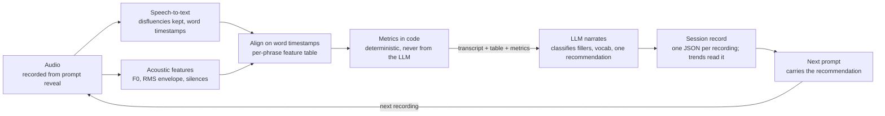

# SoundSmarter — Handoff

*As of 2026-11-05 · living document*

## Context

SoundSmarter is an app that records 30–60 seconds of extemporaneous speech, analyzes it, and returns metrics plus one recommendation. No code exists yet.

This file is the handoff for the coding agent implementing build 1. It fixes the product decisions, defines the metrics, and names the technical choices with their trade-offs. Items under **Decisions made** are settled. Items under **Open questions** are not — ask rather than pick. Provenance is marked throughout: what the product owner stated vs. what was proposed in design discussion and not yet confirmed.

**How this file is maintained.** This is the single source of truth; git history holds every version. Product decisions are made in design review and by the owner. The coding agent merges approved changes, builds, and never changes product decisions on its own. Anything it needs decided goes under **Questions for design** at the end.

## Target user

Build 1 targets young professionals, fluent English speakers, who speak under pressure: conversations with executives, interviews, presentations, moments when nerves show up as fillers and rushed starts. It is not for language learners.

- **Testers for build 1:** the owner and test user 1 (a young professional who gives presentations and gets nervous speaking).
- Filler words and prep time are the starting focus.

- Grammar correction and pronunciation/accent scoring are out of scope. Those features pull toward the ESL market (ELSA, Speak) and change the prompts, the feedback tone, and the technical stack.
- Nearest native-speaker comparables are public-speaking coaches like Yoodli and Orai. SoundSmarter's intended difference: short daily extemporaneous reps, filler-to-pause substitution as the core metric, trend tracking, and acoustic "music of speech" feedback that goes beyond transcript analysis.
- Objective mapping (dinner party vs. office vs. classroom) is deferred. Build 1 treats every user the same.

## Problem

Speakers rarely get measured feedback on how they speak, so they can't track improvement.

- Starting metrics: filler words, pauses, and prep time.
- The research behind speech metrics is still developing. Metrics will be added or revised as it does.

## Before / after

Sustained use should move a user from unaware to self-correcting on a handful of specific behaviors.

| Behavior | Before | After |
| --- | --- | --- |
| Crutch word | Doesn't know they have one | Knows the word and its rate; watches it fall across sessions |
| Fillers | Fills every gap with um / like / you know | Pauses instead; filler-to-pause ratio trends toward zero |
| Pace | Rushes, especially the first sentence | Speaking rate inside a conversational band; slows by pausing, not by dragging |
| Starting | Talks immediately, usually "so, um…" | Takes a beat; prep time is visible and treated as normal |
| Delivery | Monotone or trailing off, unaware of either | Hears where volume dropped or pitch flattened, on specific words |
| Feedback loop | None | One recommendation per recording, carried into the next prompt; a trend line per metric |

## Roadmap (Builds 1–5)

Each build is due Monday at noon, New York time.

| Build | Class asks for | SoundSmarter |
| --- | --- | --- |
| **1 · Nov 9** — Intent + throwaway prototype | PRD v1, one local interaction | Prompt (fixed bank of 5) → record → transcribe (fillers kept) → filler count. Disposable is fine. |
| **2 · Nov 16** — Plan + smallest real local version + PostHog | Riskiest part, architecture, budget | Real stack (web + Python + SQLite); session records persisted; speaking rate + prep time (moved from build 1); pauses + filler-to-pause ratio; LLM classification of lexical fillers; PostHog installed. Start collecting and hand-labeling 10–15 recordings (owner + pod member) for build 4 evals. Tests the top risk: filler detection accuracy. |
| **3 · Nov 23** — Build the core in small changes | The core product | Acoustic features (pitch, loudness); one recommendation per recording carried into the next prompt; trends within prompt type. |
| **4 · Nov 30** — Test: domain evals or user replays | Evidence it works | Evals: hand-labeled recordings (collected from build 2) vs. app counts for fillers and pauses; tester sessions. |
| **5 · Dec 7** — Ship | Live URL + 2-minute video | Cloud deploy; crutch word and vocabulary features if time allows. |

### Build 1 detail (due Nov 9)

A throwaway prototype: the smallest working interaction.

0. **Intro screen.** Before Start, show (owner-written, verbatim): "SoundSmarter listens to you talk!" then: 1. Click Start. A prompt appears and recording begins right away. 2. Start answering immediately, in a natural, full voice. 3. Be specific with your answers. It helps the quality of feedback! 4. You can stop after 30 seconds, or keep going until the 60-second limit. Do not tell the user that fillers are counted.
1. **Prompt.** Show one prompt from a fixed bank of 5 (hard-coded; owner-written, listed below). If the user doesn't like it, they can skip to the next prompt in the bank (cycling back to the first after the fifth). Skipping discards the current recording and starts a fresh one with the new prompt.
2. **Record.** Recording starts at prompt reveal. Stop is greyed out (no countdown label) until 30 s, then the user can stop; hard stop at 60 s. Skip works at any time.
3. **Transcribe.** Deepgram (Nova-2, English) with `filler_words=true` and word-level timestamps. Build 1 is built to Deepgram.
4. **Show the filler count:** "uh" and "um" only, as detected by Deepgram, as a total plus a breakdown (e.g. "um ×4, uh ×2").

**Build 1 prompt bank** (owner-written or owner-approved, 2026-11-05, revised 2026-11-09; use verbatim; mix of two- and three-beat is fine for build 1; shown in random order):

1. Which social media platform do you like most, and why? Which do you like the least?
2. Tell me about the best Halloween costume you ever wore. What did you dress as most recently?
3. What would you do on your ideal day off? It could even be your birthday if you want to have a party.
4. Who was your first favorite musician or band? What did you love about them? Who are you listening to these days?
5. What do you remember about meeting your oldest friend for the first time? What do you remember from the last time you spent time with them?
6. What TV or movie character would your friends say you most closely resemble? If you could choose one TV or movie character to hang out with, who would it be?
7. If Olympic medals were given out for anything, what 'sport' would you medal in? Eating pizza? Making up funny lyrics to popular songs? Building with AI? What actual Olympic sport would you want to compete in?
8. What’s the farthest from home you’ve ever been? What do you remember most clearly about the first day there?
9. Describe the house or apartment you grew up in. If you could walk through it right now, which room would you go to first, and why that one?
10. If you had to live in one season for the rest of your life, which one? What would you miss most from the other three?
11. Explain something you’re weirdly good at: a party trick, a shortcut, a household fix. How did you get good at it, and how would you teach it?
12. Describe a tradition your family or friends have that would sound strange to an outsider. How did it start?

*Changed 2026-11-09 by the owner:* shared online demo pulled forward from build 5 for the Nov 10 demo: invite-code links, 3 recordings per code, 30 recordings per day across all codes, "N responses left" shown. Prompt bank grown from 5 to 12 and shown in random order (5 → 12: 3 owner-written, 5 proposed in Claude Cowork and owner-approved). Dropped "If you could learn any skill overnight…": hard to answer, lacks specificity. Live at https://soundsmarter-demo.onrender.com/ (Render free tier; ~30 s cold start).

*Changed 2026-11-08 by the owner:* added the intro screen and 30 s minimum after test user 1 didn't know what to do on the first screen. Target user broadened from MBA students to young professionals; test user 1 replaces the pod member.

*Changed 2026-11-07 by the owner:* build 1 counts only "uh" and "um" as detected by Deepgram. Deepgram also flags yes/no sounds (mhmm, mm-mm, uh-uh, uh-huh, nuh-uh); these are not counted. Nothing else (no "er", "like", "you know"); scope follows what the tool reliably does.

*Changed 2026-11-05 by the owner:* speaking rate and prep time moved to build 2 to keep build 1 focused on the riskiest assumption, filler detection.

**Prep time** (build 2) = prompt reveal → first spoken word, measured after the fact from the transcript's first word timestamp. Shown neutrally ("you took 1.4 s"), never as a score.

Not in build 1: speaking rate, prep time, prompt generation (beyond the fixed bank), acoustic features, LLM classification of lexical fillers, the recommendation, trends, persistence across sessions, the iterate loop.

## Build 2 front end (shipped design, 2026-11-15)

Decided by the owner in design review, 2026-11-15. Reference implementation: `design/mockups/2026-11-15-frontend-mockup.html` (static; the dark state-switcher bar at the bottom and the click-to-scrub recording bar are mockup chrome and do not ship). Five pages, desktop-first; a mobile pass comes later. All quoted user-facing copy is owner-written; use verbatim.

**Visual system.** Paper `#fdfcfa`, ink `#222`, purple `#4a2a7d` (flat accent: numbers, primary buttons, fill bar — never a gradient), yellow `#ffd21e` (marks fillers), maya blue `#73c2fb` (marks silent pauses; value boxes). Type: Archivo Narrow 700 (Google Fonts), fallback "Helvetica Neue", Arial. On every page after the landing, a 6 px rule under the header: left half yellow, right half blue. Logo assets: `design/logo/` (SVG plus 1024 and 512 PNG).

1. **Landing.** Large logo, then "SoundSmarter", then "A self-improvement tool that listens to you speak and helps you communicate your thoughts more fluidly and confidently." Purple OK button. No header chrome on this page.
2. **Start.** Headline "Record A Response". Instruction on two lines: "A prompt will appear and recording will begin." / "At least 30 seconds of audio are needed." Purple START button, centered, enlarged.
3. **Record.** Prompt large. Soft fill bar represents 0–60 s, no numerals; thin purple tick at the 30 s mark; at 30 s a blue check appears above the tick and Stop becomes enabled; Skip works at any time; hard stop at 60 s advances to Analyze.
4. **Analyze.** Button top-center, greyed: "Analyzing (n)" counting down from 10, flipping to purple "Results" when analysis returns — the countdown number shows immediately, and the flip follows actual completion, sooner or later than the 10. Below, three reference lines: "Most common filler words:" with the list on the next line in yellow boxes (um, uh, like, you know, so, I mean, actually, basically, kind of, sort of, right, well, okay, just, literally); "Average filler words per 100 spoken words:" with **2.6** in a blue box (Bortfeld et al. 2001, conversational task); "Average prep time (pause before beginning to speak):" with **1.5 seconds** in a blue box. On-page note: "Filler word list and prep time average are placeholders, not yet research-sourced."
5. **Results.** Left: light-grey card with purple border — filler count in purple beside "Fillers", under it yellow boxes "N Ums" / "N Uh" (plural only when the count is greater than 1). To the right, vertically centered against the card: blue boxes "N fillers per 100 words" and "N seconds prep time". Then Playback (button plus progress bar), then "Transcription (N words)" with fillers highlighted yellow and silent pauses as blue duration chips, legend beneath. Bottom: purple button "Record Next Response (N left)" — the invite-code responses-left count lives here now.

Cut from the build 2 results page by the owner, 2026-11-15: the recommendation line, the fillers-by-recording trend chart, the standalone responses-left line, and pauses, filler-to-pause ratio, hitches and words per minute as displayed numbers. The metrics spec still computes and stores all metrics; this list only governs what build 2 displays.

*Build details, owner, 2026-11-15:*
- **Silent pause** = a gap of **450 ms** or more between words. Blue chips may appear after most sentences; that's intended, as each speaker's baseline (disfluency is personal).
- **Word count** ("Transcription (N words)") includes fillers. **Fillers per 100 words** = fillers ÷ non-filler words × 100.
- **Prep time** = prompt reveal → first sound, a filler included.
- If the 10 s countdown runs out before results are ready, the button reads **"Analyzing...(a bit longer)"**. In testing, results usually arrive in about 2–10 s.
- **Plurals:** plural unless the count is exactly 1, so "0 Ums", "1 Uh", "3 Ums".
- Desktop-first, but kept usable on phones.
- **Invite codes:** no per-code recording limit. One code can be reused by tester after tester; the daily cap across all codes still protects the bill (`TAKES_PER_CODE` unset or 0; `DAILY_CAP`, default 30). So the next-response button has no "(N left)" unless a per-code limit is set.
- Playback plays the recording from the browser's memory; audio isn't uploaded anywhere but the speech service.

**Placeholders needing research** (owner-acknowledged): the most-common-fillers list is the lexical-filler lexicon plus common additions, unranked and unsourced; the 1.5 s prep-time average is invented. A primary-source pass (recent disfluency research, common fillers, disfluency-rate change over the last 30 years) is planned; 2.6 per 100 words is already sourced.

## The finished loop (complete by build 3)

The product is the loop and nothing else: **prompt → record → listen → analyze → metrics → recommendation → iterate.**

1. **Prompt.** Show one prompt with structure built in — three beats, e.g. "Tell me about your last weekend: where you were, one thing that happened, how you felt about it." Each prompt is tagged by type (narrative, opinion, explanation). If the previous recording produced a recommendation, the prompt states it as this recording's focus.
2. **Record.** Recording starts when the prompt is revealed. The clock starts at the first detected word. Progress is a soft fill bar with no numerals; hard stop at 60 s; the user may stop early.
3. **Listen.** Play the recording back. The user hears themselves before seeing numbers. *(Changed 2026-11-15 by the owner: playback lives on the results screen, above the transcription; the analysis wait shows reference facts instead. Hearing the recording before seeing numbers is no longer guaranteed.)*
4. **Analyze.** Speech-to-text with disfluencies preserved and word-level timestamps, in parallel with acoustic feature extraction from the raw audio. Align the two on timestamps.
5. **Metrics.** Compute the Metrics spec deterministically in code. Show per-recording values and the trend across prior recordings of the same prompt type.
6. **Recommendation.** One LLM call sees the transcript, the per-phrase feature table, and the metrics; it returns filler classifications, two or three vocabulary suggestions, delivery notes tied to specific words, and exactly one recommendation.
7. **Iterate.** Persist the session record. The next prompt carries the recommendation as its focus.

Not in the finished loop: objective mapping / onboarding by use case, grammar, pronunciation scoring, mid-recording prompts, LLM-generated follow-up questions, multi-user accounts (unless the demo requires them).

## Pipeline

Two parallel passes over the audio — transcript and acoustics — aligned on timestamps, with deterministic metrics in code and the LLM narrating on top.

```
audio → [ speech-to-text ∥ acoustic features ] → align → metrics (code) → LLM → session record → next prompt → (loop)
```



The transcript and the acoustic pass never see each other until alignment. Everything numeric is computed before the LLM is called. The loop closes when the next prompt carries the recommendation.

## Metrics spec

Every number comes from code, never from the LLM. All rates are normalized to speaking time; trend comparisons are made only within prompt type; acoustic measures are reported relative to the user's own prior recordings, never as absolutes.

| Metric | Definition | Notes |
| --- | --- | --- |
| Prep time (ms) | Prompt reveal → first word onset | Stored and shown, framed neutrally. Never a penalty. |
| Speaking rate (WPM) | Words ÷ time from first word to end, pauses included | A band, not a floor. Commonly cited conversational range is roughly 140–160 WPM; treat as a starting default. |
| Articulation rate (WPM) | Words ÷ voiced time, pauses excluded | Ratio to speaking rate shows whether a slowdown came from pausing (intended) or dragging syllables. |
| Rate over time | Speaking rate in sliding windows (suggest 5 s) | Catches rushing, especially at the start. |
| Filler count / rate | Vocalized (um, uh, er) + lexical (like, you know, sort of, kind of, basically, actually, right?) per minute of speaking time | Vocalized fillers come from the STT disfluency flag. Lexical fillers are real words and need context classification by the LLM ("I like jazz" vs. "it was, like, fine"). |
| Top words | Most frequent words per recording, stopwords excluded | Feeds crutch-word detection and vocabulary suggestions. |
| Crutch word | The non-content word that recurs most across sessions | Computed per recording; surfaced as "your crutch" only once stable across N recordings (suggest N = 5). One recording is noise. |
| Pauses | Count, mean, max duration of silences ≥ threshold (suggest 300 ms, tunable) | Split by position: boundary (between clauses or thoughts) vs. hesitation (mid-clause). Position comes from word timestamps plus clause boundaries in the transcript. |
| Filler-to-pause ratio | Fillers ÷ (fillers + hesitation pauses) | Headline metric. Directly measures the substitution behavior the advice is about. |
| Hitches | Restarts, repeated words ("I— I went"), false starts | From the disfluency transcript, not the audio. |
| Pitch | F0 mean, range, variability per phrase; terminal-rise flag on declaratives (uptalk) | Relative to the user's baseline. Range is personal. |
| Loudness | RMS energy envelope; trailing-off at phrase ends; dynamic range | Relative within the recording. Mic and room make absolute dB meaningless. |
| Ended cleanly | Stopped early vs. hit cutoff; landed vs. trailed off | From end-of-recording energy and the transcript's last clause. |

## Session record

One JSON object per recording is the contract between every part of the app: the recorder writes timing and audio, the analysis pipeline writes transcript, acoustic features, and metrics, the LLM writes analysis, and the UI and trend charts only read. Shape is a proposal; field names are the agent's to settle.

```json
{
  "session_id": "uuid",
  "user_id": "string",
  "created_at": "ISO-8601",
  "prompt": {
    "id": "p_017",
    "type": "narrative | opinion | explanation",
    "text": "Tell me about your last weekend: ...",
    "focus": "Pause instead of 'like'"
  },
  "timing": {
    "reveal_ms": 0,
    "first_word_ms": 1420,
    "end_ms": 38900,
    "stopped_early": true,
    "prep_ms": 1420
  },
  "audio": { "uri": "...", "sample_rate": 16000, "duration_ms": 38900 },
  "transcript": {
    "provider": "deepgram | assemblyai",
    "text": "so, um, last weekend ...",
    "words": [
      { "w": "so", "start_ms": 1420, "end_ms": 1610, "conf": 0.98, "filler": "lexical" },
      { "w": "um", "start_ms": 1700, "end_ms": 2050, "conf": 0.91, "filler": "vocalized" },
      { "w": "last", "start_ms": 2400, "end_ms": 2600, "conf": 0.99, "filler": null }
    ]
  },
  "acoustic": {
    "frame_ms": 10,
    "f0_hz": ["...per frame, null when unvoiced"],
    "rms": ["...per frame"],
    "phrases": [
      {
        "start_ms": 1420, "end_ms": 6800,
        "wpm": 172, "f0_mean": 118, "f0_range": 41, "rms_mean": 0.21,
        "pause_before_ms": 0, "terminal_rise": false
      }
    ]
  },
  "metrics": {
    "prep_ms": 1420,
    "speaking_wpm": 148,
    "articulation_wpm": 171,
    "wpm_windows": [172, 160, 141, 133, 139, 150, 146],
    "fillers": { "vocalized": 4, "lexical": 6, "per_min": 16.0 },
    "top_words": [["like", 5], ["weekend", 3]],
    "pauses": { "count": 7, "mean_ms": 480, "max_ms": 1100, "boundary": 4, "hesitation": 3 },
    "filler_to_pause": 0.77,
    "hitches": 2,
    "pitch": { "f0_mean": 121, "f0_range": 58, "terminal_rises": 2 },
    "loudness": { "dynamic_range": 0.34, "trailing_off": 3 },
    "ended_cleanly": true
  },
  "analysis": {
    "model": "...",
    "crutch_candidates": ["like"],
    "vocab_suggestions": [ { "said": "really good", "try": "memorable" } ],
    "delivery_notes": [
      { "word_index": 41, "note": "Volume dropped and rate rose through 'and then we tried the'." }
    ],
    "recommendation": "Next response: when you feel a 'like' coming, stop and wait instead."
  }
}
```

The `filler` field on each word is written by the LLM classification step, not by the STT, so the transcript can be re-classified without re-transcribing. Trend charts read `metrics` only.

## Technical choices

Each option lists what it buys and what it costs. **Lean** is the suggested starting point, not a decision.

### Speech-to-text

*Changed 2026-11-15 by the owner:* speech-to-text moves to **[CrisperWhisper 2.0](https://github.com/nyrahealth/CrisperWhisper)** (verbatim mode, word timestamps) from Build 2, called through Nyra's hosted API ([docs](https://docs.nyra-labs.com/quickstart); $0.90 per audio hour; prepaid wallet), not self-hosted. The owner tried the online demo and it caught every filler. Test C (Deepgram Nova-2 vs. CrisperWhisper 2.0 vs. ElevenLabs Scribe v3, against hand counts) runs as evidence, not as the deciding test. Open: commercial terms of the API, and Deepgram's future role (see Questions for design).

*Test C results, 2026-11-15* (4 phone recordings, one speaker; details in `experiments/stt-compare/RESULTS.md`):
- On the three normal recordings (18 hand-counted fillers): Deepgram Nova-2 caught 13 (72%); CrisperWhisper 2.0 and Scribe v3 caught all 18.
- Deepgram dropped the opening filler on a phone recording too, so the leading-filler problem is the Deepgram model, not the browser. Its first-word time was 2 s late (4.00 s vs. 2.00 s), which would have overstated prep time.
- No service tells a filler "um" from "um" said as a word ("an um"); CrisperWhisper also invented one filler ("clear M sound" → "[UM] sound"). Handle with the AI classification step (owner: AI for classification is fine). Rare in normal speech.
- CrisperWhisper's per-token labels (repetition, cut-off, correction) worked, which supplies the Hitches metric directly.
- Scribe v3 tied CrisperWhisper on counts and has a commercial license; CrisperWhisper stays the pick for its labels and timing accuracy. Scribe is the fallback candidate.

**Deepgram, Nova family, `filler_words=true`** — [docs](https://developers.deepgram.com/docs/filler-words)
- Upsides: one flag; word timestamps standard; fast. Documented token set: uh, um, mhmm, mm-mm, uh-uh, uh-huh, nuh-uh.
- Downsides: English only. Only those 7 tokens — "like", "you know" still need classification. Deepgram's own pages disagree on which models support it (Nova-3 vs. Flux); test on the exact model.
- Lean: **try first.**

**AssemblyAI, `disfluencies: true`** — [docs](https://assemblyai.com/docs/sdk-references/js/pre-recorded-audio)
- Upsides: comparable; recent timestamp-accuracy work on Universal-3 Pro.
- Downsides: word timestamps are opt-in in the current SDK (`timestamps=True`) at a small latency cost. Their README says parameter names have changed — fetch [llms.txt](https://assemblyai.com/docs/llms.txt) before writing code.
- Lean: alternate.

**OpenAI Whisper API**
- Upsides: cheap, familiar.
- Downsides: strips um/uh by default; prompting to keep them is unreliable; word timestamps are a separate option. Undermines the defining feature.
- Lean: no.

**[CrisperWhisper](https://github.com/nyrahealth/CrisperWhisper) (open source)**
- Upsides: verbatim mode built for disfluencies; word timestamps; self-hosted, no per-call cost.
- Downsides: needs a GPU and ops. More setup than build 1 wants.
- Lean: if cost or privacy matters later.

### Acoustic features

**parselmouth (Praat bindings, Python)**
- Upsides: phonetics-research standard for F0 and intensity; robust pitch tracking.
- Downsides: Praat semantics have a learning curve.
- Lean: **use for F0 and intensity.**

**librosa**
- Upsides: easy; `pyin` for F0, RMS envelope, windowing.
- Downsides: `pyin` is slow; pitch less precise than Praat.
- Lean: fine for RMS and windows.

**openSMILE / eGeMAPS feature set**
- Upsides: 88 curated paralinguistic features — someone already picked what matters.
- Downsides: hard to explain to a user; overkill for build 1.
- Lean: later.

### Pause detection

**Gaps between STT word timestamps**
- Upsides: no extra dependency; already aligned to words.
- Downsides: timestamp error is tens of ms; fine at a 300 ms threshold, not below.
- Lean: **first.**

**VAD (silero-vad, webrtcvad) on the audio**
- Upsides: independent of STT; catches breaths and noise.
- Downsides: extra dependency; needs its own alignment.
- Lean: if word gaps prove noisy.

### LLM role

**One structured call** — transcript + feature table + metrics → JSON (filler classification, vocab, delivery notes, one recommendation)
- Upsides: one round trip; one prompt to tune; cheap.
- Downsides: classification and coaching share a prompt; it gets long.
- Lean: **start here.**

**Two calls** — classify fillers, then coach
- Upsides: cleaner classification; reusable.
- Downsides: double latency and cost.
- Lean: only if classification quality suffers.

### Audio-native LLM (model listens to the clip directly)

- Upsides: tone commentary with zero feature engineering; demos well.
- Downsides: opaque, non-reproducible, no number to plot week over week, can't anchor to a word.
- Lean: side experiment, not the pipeline.

### Pronunciation (deferred)

**Azure Speech pronunciation assessment, Speechace**
- Upsides: phoneme-level scoring.
- Downsides: separate integration; pulls toward ESL framing. Cheap proxy if ever needed: STT low-confidence words.
- Lean: not build 1.

### Client

**Web app: browser `MediaRecorder` → upload → server**
- Upsides: no app store; one codebase; demo-friendly.
- Downsides: Chrome records WebM/Opus — transcode server-side to 16 kHz mono WAV before feature extraction. Safari quirks. Mic-permission UX.
- Lean: **web.**

### First-word detection

**Post hoc from STT's first word timestamp**
- Upsides: accurate; no live logic.
- Downsides: no live clock start during recording.
- Lean: **use for the stored `prep_ms`.**

**Client-side energy threshold or silero-vad (WASM)**
- Upsides: live UI cue.
- Downsides: false triggers on breath and room noise.
- Lean: only for the UI cue, never for the metric.

### Backend

**Python (FastAPI or similar)**
- Upsides: native home for parselmouth and librosa.
- Lean: **Python.**

**Node**
- Upsides: matches a JS front end.
- Downsides: would shell out to Python for acoustics anyway.
- Lean: no.

### Storage

**SQLite with a JSON column per session record; audio on local disk**
- Upsides: zero ops for build 1.
- Downsides: migrate to Postgres and object storage if multi-user.
- Lean: **build 2.**

Before writing any provider call, confirm flag names and model support against the provider's current docs; both STT providers' documentation has moved recently.

## Ideas considered

| Idea | Status | Why |
| --- | --- | --- |
| Filler words as the defining feature | Adopted | Owner's call. STT stripping is solved by a provider flag; lexical fillers need LLM classification. |
| Vocabulary as the second feature | Adopted, sequenced to build 5 | Owner's call. Second in priority, built after the filler/pause core. Definition still open (see Open questions). |
| Acoustic "music of speech": hitches, volume, tone | Adopted | Owner's call. Done with signal processing on the raw audio, not a model. |
| Grammar analysis | Deferred | Pulls toward the ESL market; spoken grammar is full of fragments and restarts, so an LLM over-flags. |
| Pronunciation / accent scoring | Deferred | A transcript can't do it; needs a phoneme-level API. Frame as clarity, not accent, if revisited. |
| Timer starts at first word | Adopted | Owner's call. Recording starts at prompt reveal so the lead-in "so, um…" is captured. |
| Visible countdown with numerals | Rejected | Produces rushing. Soft fill bar, hard stop at 60 s. |
| Mid-recording prompts | Rejected | On-screen text while speaking causes hitches and restarts — the app would be generating the artifact it measures. |
| Structure built into the prompt (three beats) | Adopted | Hands the speaker a plan before the first word; natural 30–45 s arc. |
| Follow-up question between recordings | Deferred to build 2 | Closer to real conversation. Templated per prompt first; LLM-generated from the transcript later. |
| Prompt tagging by type; trends within type | Adopted | Prompt difficulty is a confound; narrative produces fewer fillers than opinion or explanation. |
| Crutch word surfaced only once stable | Adopted | Three "likes" in one recording is noise; the same word across five recordings is a crutch. |
| Filler-to-pause ratio as headline metric | Adopted | Measures the substitution behavior directly. |
| Exactly one recommendation per recording, carried into the next prompt | Adopted | Turns "iterate" into a loop rather than a series of report cards. |
| Allow stopping early; track ended-cleanly | Adopted | Ending cleanly vs. trailing off is a skill. |
| Audio-native LLM listening to the clip | Side experiment | A vibe, not a number. Compare against hand-rolled features; don't build the pipeline on it. |
| Objective mapping / onboarding by use case | Deferred | Owner's call: post-build-1. |

## Decisions made

The first list is settled and should not be relitigated. The second list is proposals the owner has read and not objected to; treat them as the working plan and flag — don't silently change — any you disagree with.

**Stated by the owner**

1. Target user is young professionals (fluent English speakers) who speak under pressure. Testers: the owner and test user 1. *(Changed 2026-11-08; was MBA students + one pod member. Changed 2026-11-10 by the owner: "native" → "fluent". Fillers are a nerves-and-habit problem, not a language problem; still not for language learners.)*
2. Filler words are the defining feature; vocabulary is second in priority and scheduled for build 5 if time allows.
3. The app analyzes the acoustic "music" of speech — hitches, volume, tone — beyond transcript-plus-LLM.
4. Metrics are computed per recording and tracked over time: words per minute, fillers per minute, repetition of fillers and most-used words (the crutch), pause metrics.
5. The timer does not start until the first word is spoken; preparation time is part of the skill.
6. Continuous flow of speech is the essential UI problem: good prompts, natural progression of thought, structure set up before speaking.
7. Objective mapping (who the user is speaking to) is deferred.
8. The finished loop is prompt → record → listen → analyze → metrics → recommendation → iterate, and nothing more.
9. Builds follow the roadmap above; build 1 (due Nov 9) is prompt (fixed bank of 5) → record → transcribe → filler count. *(Changed 2026-11-05: speaking rate and prep time moved to build 2.)*
10. Prep time = prompt reveal → first spoken word, from the STT first-word timestamp; framed neutrally.
11. The build 2 front end ships the five-page design of 2026-11-15 (see **Build 2 front end** below). No built-in education in build 2: no recommendation line, no trend chart on results.
12. **Build 3 storage (2026-11-21):** hosted Postgres on Supabase replaces SQLite (proposed decision 11 below). Two projects: `soundsmarter-dev` (local `.env`) and `soundsmarter-prod` (Render). Schema lives in `prototype/db/migrations/`, run in dev first, then prod. RLS on every table; each user reads and adds only their own rows.
13. **Sign-in (2026-11-21):** email + password, email confirmation off (Supabase's built-in mailer only reaches team addresses). No password reset for now.
14. **What is stored per recording (2026-11-21):** metrics and the full transcription response (words + timestamps), so metrics can be recomputed. No audio. A recording is saved only after the user accepts the consent notice at sign-up.
15. **Demo-code visitors (2026-11-21):** keep the instant-results flow; nothing is saved for them. Records exist only for signed-in users.
16. **Build 3 scope (2026-11-21, owner):** decisions 16–24 supersede `design/2026-11-21-build3-brief.md` wherever they differ.
17. **Consent (2026-11-21):** consent is required to create an account; no consent, no account. Decision 14 stands: every signed-in recording stores metrics and the full transcription response, no audio.
18. **English only (2026-11-21):** stated before sign-up and before the first recording.
19. **Baseline (2026-11-21):** the first 10 recordings, 2 per family, families interleaved. During baseline the user gets playback and transcript, no numbers. After the 10th, the baseline map appears. From the 11th on, each result is shown against the user's baseline for that family.
20. **Send or Discard (2026-11-21):** nothing goes to transcription until the user confirms. After stopping, the user chooses Send or Discard. Discard gives a new prompt from the same family, costs nothing, and is recorded like a skip.
21. **Unusable audio (2026-11-21):** caught before a row is saved: no numbers, nothing stored, a re-record message. Before upload: too little sound or bad input level. After transcription: too few words, implausible words per second, or non-English text.
22. **Prompt engine (2026-11-21):**
    - Five families: Describe, Narrate, Argue, Invent, Explain. Three modes: text, image, audio. Explain has no audio.
    - Sources: `design/2026-11-21-prompts-text-draft.csv` and `design/2026-11-21-audio-stimuli-draft.csv`. Only rows the owner marks approved are served.
    - Prompts and stimuli live in the database. Each stimulus carries its license and credit. A prompt whose stimulus file is missing is never served.
    - A user never sees the same prompt twice. Skips and discards count as seen.
    - Each recording stores: prompt id, family, mode, variant, stimulus id, position in the session, and prompts skipped or discarded before it.
    - For audio prompts, prep time runs from the end of the clip.
23. **Metrics stored per recording (2026-11-21):**
    - Fillers, repetitions, cut-offs, mid-sentence pauses, sentence-end pauses, speaking rate, articulation rate, prep time.
    - Repairs: each unbroken run of cutoff, disfluent and repetition tokens.
    - CrisperWhisper "correction" count: stored, never displayed.
    - Raw counts by form for the word list in `design/2026-11-21-word-list-and-prompt-guidelines.md` (tiers 1 and 2), with a word-list version number.
24. **Pages (2026-11-21):** in the current style: sign-up with consent, sign-in, account, baseline map, trends within family.
25. **Build 3 follow-ups (2026-11-21, owner):**
    - **Scope:** text and image prompts this build; audio prompts and the baseline/trends pages after, if time runs out. Baseline uses text and image prompts.
    - **Comparisons** (baseline map, results vs. baseline, trends) are by family × mode.
    - **A family that runs out** of unseen prompts for a user stops being served to that user.
    - **Session:** a new session starts after 30 minutes with no recording (for "position in the session").
    - **Language:** transcription is no longer forced to English; a recording the service detects as non-English is rejected as unusable.
    - **Background sending:** after Send, the next prompt starts automatically, with no extra click, while the previous recording is analysed in the background. *(Changed 2026-11-22 by the owner; was an optional "next prompt" link.)*
    - **Send/Discard** applies to signed-in users; demo-code visitors keep the instant flow.
    - **Sign-up** needs a personal sign-up code supplied by the owner, separate from the existing demo codes. Codes live in a Supabase table (`signup_codes`); a database check at sign-up rejects a missing or used code, so the publishable key alone can't create accounts. One code = one account.
    - **Caps:** 20 recordings a day per signed-in account (sent + rejected both count). Demo codes keep the current shared daily cap, unchanged.
    - **Image stimuli:** single scenes first, pulled from museum open-access collections (public domain), license and credit recorded; the owner approves each image.
    - **Account deletion:** not in Build 3; a known gap.
    - **Copy:** consent: "SoundSmarter stores the transcript, word timings and metrics of every recording sent. Audio is not stored. ☐ I agree." English only: "SoundSmarter works in English only. Recordings in other languages are not analysed."
    - **Prompt approval:** the owner reviews `design/prompt-review/index.html` (built from the CSVs) and approves in chat; the agent edits the CSV `status` column and regenerates the database seed.
    - **Stimulus files** live in a public Supabase Storage bucket in each project.
    - **Definitions:** speaking rate = non-filler words per minute, first word start to last word end; articulation rate = the same minus silent pauses of 450 ms or more; a sentence-end pause follows a word ending in `.`, `?` or `!`; otherwise it is mid-sentence.
    - **Unusable audio thresholds:** fewer than 15 words; speaking rate outside 0.8–5 words per second; mostly near-silent or clipping (browser level check).
26. **Filled share (2026-11-21):** filled hesitations ÷ (filled + silent hesitations). Silent hesitations are mid-sentence pauses of 450 ms or more; a filler with an adjacent pause counts as one filled hesitation. Stored in two versions: by count and by time. The map shows the count version, per family.
27. **Prompt voice (2026-11-22, owner):**
    - Prompts sound warm and human, and speak to the user as "you". The "no second person" rule covers app copy only, never prompts.
    - Easy to talk about, difficult to describe: easy to take on emotionally, demanding in word choice. Ordinary discomfort (a group project, speaking to a crowd) is fine; the user can skip.
    - Every question in a prompt must be one a person would sensibly ask. No question with an obvious answer ("what goes on in a kitchen").
    - No fixed sentence pasted onto every prompt in a family.
    - Stakes and constraints make a prompt answerable: a situation that gives a reason to answer (a prize, a guest, a choice of one) and a limit that gives the answer a shape, without boxing the speaker in.
    - The number of beats is not fixed. It depends on what is being asked: a simple first beat (a kitchen is a kitchen) needs less thought, so the prompt can carry more.
    - Invent / text / before ("Tell the story that ends this way") is retired as unwieldy. Hypotheticals ("If you had to...") replace it, as Invent / text / whatif.
    - Argue: a plain question, no "Argue for or against:" lead-in, and not necessarily two-sided. A question with a range of answers gives more leeway ("How many days is ideal to work in office or on-site?"). "Give at least two reasons." is a header shown above every argue prompt, not part of each prompt.
    - Invent / text / after *(provisional; see Questions for design)*: a line of fiction followed by a question about it. The user engages with the fictional world inventively and is not asked to continue the story in its narrative voice. Most small stories need a named character to anchor to; ones about an environment, an organism or a system (a town, a street, an orchestra) do not. ("Maryanne opened the top drawer of the old desk, and found a carefully folded note." Who wrote it, and what did it say?)
    - Explain / procedure: just "Explain how...", with "you" where it reads naturally. No instruction about steps or common mistakes; the speaker decides how to teach it.
    - This overrides rules 2 and 10 in §B3 of `design/2026-11-21-word-list-and-prompt-guidelines.md`.

**Proposed, not yet objected to**

1. Two WPM figures: speaking rate and articulation rate.
2. Lexical fillers classified by the LLM with context; vocalized fillers from the STT flag.
3. Crutch word shown only once stable across N recordings.
4. Pauses split by position; filler-to-pause ratio as the headline metric.
5. Recording starts at prompt reveal; prep time stored and framed neutrally.
6. No numeric countdown; soft fill bar; hard stop at 60 s; stopping early allowed.
7. Structure inside the prompt; no mid-recording prompts.
8. Prompts tagged by type; trends compared within type.
9. Exactly one recommendation per recording, carried into the next prompt as its focus.
10. Numbers come from code; narration comes from the LLM.
11. Web client, Python backend, SQLite from build 2 (build 1 is a throwaway).

## Open questions

Raise these rather than resolve them.

**Product**

- [ ] Vocabulary feature (build 5): precision suggestions ("really good" → a specific word), a lexical-diversity score, or tracking whether suggested words get used in later recordings? Only the last one creates a habit loop; it also needs the most sessions to show anything.
- [ ] Prompt bank (build 1 uses a fixed bank of 5; prompt generation later): how many prompts, who writes them, how many per type. The three-beat structure needs to be consistent across the bank or the metrics drift.
- [ ] Listen before metrics: is playback mandatory before the numbers appear, or optional?
- [ ] Playback: raw audio, or with fillers and hesitation pauses highlighted on a waveform?
- [x] Multi-user accounts, or single-user for the demo? *Multi-user with sign-in, 2026-11-21 (decision 13).*
- [ ] Is a particular LLM provider required for the recommendation call?

**Tuning defaults (proposed values, all adjustable)**

- [ ] Pause threshold: 300 ms.
- [ ] Crutch stability: N = 5 recordings.
- [ ] Speaking-rate band: roughly 140–160 WPM as the starting default.
- [ ] Lexical filler lexicon: like, you know, sort of, kind of, basically, actually, right?, so (sentence-initial), I mean.
- [ ] Rate-over-time window: 5 s.
- [ ] Hard stop: 60 s; minimum recording length before analysis runs: suggest 10 s.

**Technical**

- [ ] STT provider: Deepgram first, AssemblyAI as alternate — confirm on a real sample that fillers and word timestamps both come back on the chosen model.
- [ ] Clause boundaries for pause position: from STT punctuation, or a light parse? STT punctuation is cheaper and probably enough.

## Questions for design

Added by the coding agent for the next design review. Resolved items move into **Decisions made**.

- [ ] **Invent story snippets need reshaping** (owner, 2026-11-22): the Invent / text / after prompts (`inv-t-01` to `inv-t-25`, a line of fiction plus a question) are not working. The owner will work out the principles more systematically before another pass; none is approved until then. The hypotheticals (Invent / text / whatif) are good and stay.
- [ ] **A header for every family** (owner, 2026-11-22): each family will get a line above the prompt saying what kind of response is wanted. Wording to be decided. Only Argue has one so far ("Give at least two reasons.").
- [ ] **Image and audio prompt wording** (owner, 2026-11-22): the old on-screen templates ("Describe this picture. Say what is happening and what stands out.") were deleted as not good. Image prompt wording comes with the next commit.

- [ ] **Numbers, not AI text** (owner, 2026-11-15): minimize AI-generated text feedback; show the user numbers; a numbers-first look is a core design element, away from the "AI slop" look (after trying Yoodli, which drops fillers and gives generic AI feedback). *Owner, same day:* AI for **classification** is fine (e.g. "like" as filler vs. verb); AI-written **feedback prose** is what to minimize. This conflicts with the finished loop step 6 (LLM writes vocabulary suggestions, delivery notes and the recommendation) and Proposed decision 10 ("narration comes from the LLM"). Design to propose what survives, e.g. the recommendation becomes a templated line driven by the numbers.

- [ ] **Next-build ideas for a research-backed design discussion** (owner, 2026-11-17). Owner is gathering the research; discuss with Claude in research context before anything is built.
  - **Scoping page up front:** ask what the user wants help with before any prompt. Conflicts with the deferred objective mapping (Target user) and PRD out-of-scope #2.
  - **Prompt types, including visual prompts:** the user responds to a non-text impetus, e.g. describe a picture or animation; say what is happening, has happened, or will happen.
  - **Short, shifting prompts to create instability:** instead of one 30 s prompt, 6 × 10 s or 4 × 15 s responses with quickly changing prompts. Needs research on time pressure, task switching and prompt type vs. filler/pause rate. Leads: Christenfeld 1995; picture-description tasks ("Cookie Theft") in speech research; cognitive load and filler rate.
  - **Famous speakers on the analysis page:** show SoundSmarter results for famous speakers. Scripted speeches (e.g. Churchill) show few fillers, so they aren't a like-for-like comparison; unscripted moments compare better: press conferences (JFK, Obama), talk shows (Carson, Cavett), live debates (Buckley–Vidal 1968), Prime Minister's Questions. Film clips raise copyright questions; public-domain material is safer.
  - **Scope: do fewer fillers make a better speaker?** Obama is widely seen as an excellent speaker yet says "uh" often when unscripted; Clark & Fox Tree 2002 treat um/uh as signals listeners use. Wit is content; SoundSmarter measures delivery only. The PRD's goal is awareness, not "eliminate fillers"; a famous-speaker comparison could undercut that unless it includes great speakers with high filler counts. Owner's questions: who are the great extemporaneous speakers? Is it rapier wit? How do you define it?
  - **More prompt modes and task types** (owner, 2026-11-17): **audio prompts** (play a short clip, the user describes it), alongside text and visual. Task types: describe something; give an opinion; estimate or reason something through; solve a puzzle aloud; continue a story from a given opening; more to come. Question: does filler/pause rate differ by mode and task type?
  - **Terminology:** in competitive speech, "extemporaneous" = prepared, delivered without a script; "impromptu" = little or no prep. SoundSmarter is closer to impromptu, but the docs say extemporaneous.

- [ ] **Fail states: bad audio** (owner, 2026-11-17): no design yet for when the app gets poor audio. Owner tested in a loud room with several people talking at once; the app returned metrics as normal on a transcript that started readable, then broke down into fragments and mixed languages (excerpt: "sv delleissant Fell timber ... incred incred76 incred norms¿ 원래 careg") and other people's speech. Design needs guidelines for:
  - **Detection:** how the app knows the audio is bad (e.g. low transcription confidence, non-English or garbled words, more than one speaker, background noise level).
  - **Prevention:** e.g. a mic or room check before recording.
  - **Response:** what the user sees, e.g. hold back the metrics, warn alongside them, or ask for a re-record in a quieter place.
  - **Other fail states to cover in the same pass:** silence or near-silence, too short, mic blocked (already handled), transcription service down or slow.

- [ ] **Next build: proposed work** (owner, 2026-11-17). Differs from the Build 3 roadmap row (acoustic features, one recommendation per recording, trends within prompt type); design to decide what Build 3 is.
  - **Evaluate CrisperWhisper output:** what it returns beyond words and timestamps (e.g. per-word confidence) and which metrics that makes possible.
  - **Expand the filler list:** er, ah, erm, like, well, so, you know, and other common ones. "Like", "well", "so" and "you know" are also real words, so they need classification (filler vs. real use); this ties to "Numbers, not AI text" (AI for classification is fine).
  - **Track more metrics** and build them into a **speech-pattern profile** per user.
  - **Sign-in and a real database with row-level security (RLS)**, leaving the shared demo. RLS is a database feature (Postgres, e.g. Supabase), not SQLite, so this reopens decision 11 (SQLite).
  - **User profile + scoping:** who the user is and what they want to accomplish. Choices to be research-based.
  - **Per-user cap on CrisperWhisper calls** (replaces or adds to the shared daily cap).
  - **Profile page:** establishes the user's speech-pattern profile, then shows trends over time.
  - **Does practice change speech?** Decide how to measure whether a user's metrics change across sessions or within a practice session, and what counts as a real change vs. noise.

- [ ] **What is SoundSmarter?** (owner, 2026-11-17): a consumer self-improvement product, or a tool that builds a research repository on the circumstances under which people's filler and pause use changes (text vs. visual vs. audio prompts; describe vs. opinion vs. estimate vs. puzzle)? Or both: the consumer app as the data source. The answer shapes consent, data storage, the profile and the metrics.

- [ ] **Evaluate content, not just delivery?** (owner, 2026-11-17; to explore in design/research before anything is built). "Sounding smart" is also what you say. Owner is unsure it fits the scope. Options, roughly from most to least defensible:
  - **Structure of the response:** was the question answered? Was a reason given? Closer to interview training; may be out of scope.
  - **Vocabulary suggestions:** easy to build; unclear whether it belongs.
  - **Speaking well on an unfamiliar subject** ("how to talk about books you haven't read"): probably out of scope.
  - Caveat: only some content can be shown to be right or wrong. Also touches "Numbers, not AI text", since content feedback tends to be AI-written prose.

- [x] **Leading filler is never counted** (owner, Build 1 testing, every recording): the "uhh"/"umm" at the very start of a recording is missing from both the count and the transcript. *Resolved 2026-11-15 by test C:* the Deepgram model drops it (it happened on a phone recording too, no browser involved); CrisperWhisper and Scribe v3 both caught it. Fixed by the move to CrisperWhisper. Browser clipping not fully ruled out until test A/B runs.
- [ ] **Standard A/B test for the underlying tech** (owner, 2026-11-08): test every audio or speech-to-text choice the same way, as a matter of course, not just Deepgram. Proposed protocol:
  - **A. Simultaneous capture:** record the same recording on the phone and in the browser at the same time; compare counts. Isolates browser recording settings (e.g. noise suppression).
  - **B. Fixed playback:** play one phone recording into the app in Brave, Chrome and Safari; compare counts. Isolates the browser.
  - **C. Provider comparison:** send the same saved recordings straight to each speech-to-text option (Deepgram Nova-2 / Nova-3, AssemblyAI, Whisper) in code, no microphone involved; compare counts against the owner's hand count. Isolates the model.
  - Reuse the same small set of hand-counted recordings each time; it can grow into the Build 4 eval set.
