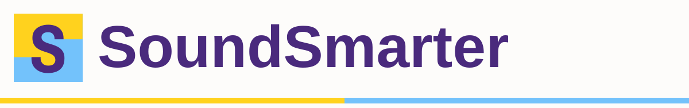
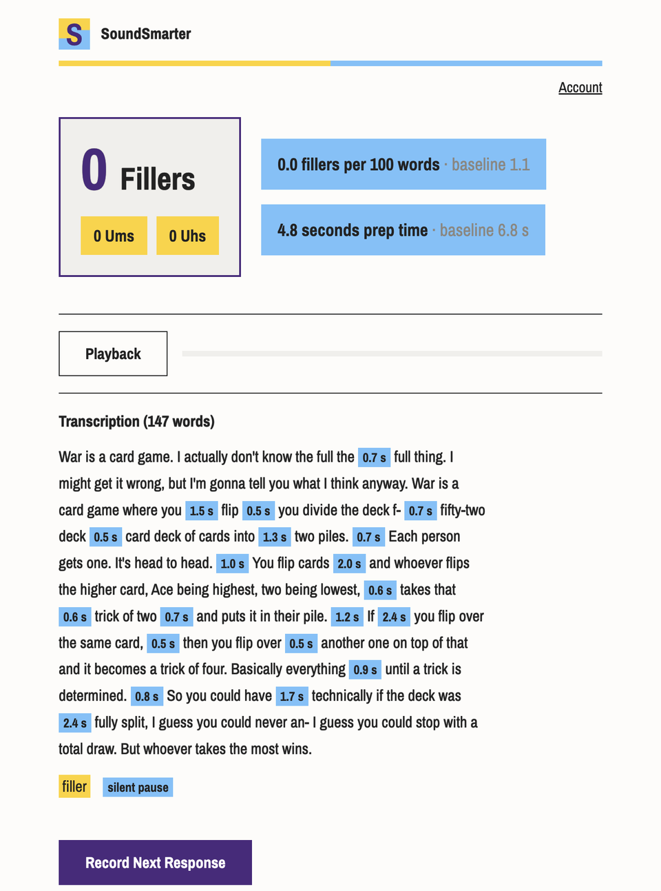

<h1></h1>

> SoundSmarter measures fillers and pauses across five kinds of prompts, sets a personal baseline, and tracks each new recording against it.

- **Builder:** Duncan Lindsay (`@duncanlindsay`), Pod 10, NYU Stern "Building with AI", Fall 2026
- **Product Page (PRD and build log):** https://building-with-ai-f26.github.io/dal380-soundsmarter/
- **Live app:** https://soundsmarter-demo.onrender.com/ (needs a demo code, or an account made with a personal sign-up code; the first load can take about 30 seconds)
- **Status:** Build 3, Nov. 23, 2026 (tag `build-3`)

## What it does

1. **Account.** Create an account with a personal sign-up code and agree to what is stored: the transcript, word timings and metrics of every recording. Audio is not stored. English only.
2. **Prompt.** One of 206 prompts in five families: Describe, Narrate, Argue, Invent, Explain. Text, or an image.
3. **Record.** 30 to 60 seconds in the browser, then Send or Discard.
4. **Analyze.** Nyra Labs CrisperWhisper 2 keeps every filler and times every word. The app computes the numbers in code. For accounts, unusable recordings are rejected.
5. **Baseline.** The first 10 recordings give playback and a transcription, no numbers.
6. **Results.** After the 10th, the Account page shows a baseline table by family and mode. From the 11th, each recording's numbers appear beside the baseline.

Demo-code visitors get a shorter version: 12 prompts, numbers straight away, nothing stored.

 

## How it is built

- **Browser:** one page, `prototype/index.html`. Records with the browser's MediaRecorder.
- **Server:** Python (FastAPI), `prototype/server.py`, hosted on Render.
- **Speech-to-text:** Nyra Labs CrisperWhisper 2, called from the server.
- **Accounts and data:** Supabase (sign-in, Postgres with row-level security, prompt images). Only the server writes recordings.
- **Analytics:** PostHog, relayed through the server.

## Run it locally

Needs Python and [uv](https://docs.astral.sh/uv/).

1. Copy `.env.example` to `.env` and fill in `NYRA_API_KEY`. Without anything else, the demo flow works. For accounts, also fill in the three `SUPABASE_` values from your own Supabase project, then in that project: run the files in `prototype/db/migrations/` in order, load `prototype/db/seed/prompts.sql`, add a row to `signup_codes`, and upload the prompt images to a public `stimuli` bucket (image prompts are skipped without them).
2. `cd prototype && uv sync`
3. `uv run uvicorn server:app --reload --port 8001`, then open http://localhost:8001
4. Tests: `uv run pytest`

Keys live in `.env`, which git ignores. Never commit them.

## Repository map

| File / folder | Purpose |
| --- | --- |
| [`prototype/`](./prototype/) | The app: server, page, metrics, database migrations, tests |
| [`docs/index.html`](./docs/index.html) | Product Page: PRD and weekly build log |
| [`HANDOFF.md`](./HANDOFF.md) | Product source of truth: decisions and roadmap |
| [`SECURITY.md`](./SECURITY.md) | Build 3 security audit: what was checked, fixed and left open |
| [`AGENTS.md`](./AGENTS.md) | Rules, commands and shipping steps for coding agents |
| [`design/`](./design/) | Design briefs, prompt and image sources, review notes, logo |
| [`experiments/stt-compare/`](./experiments/stt-compare/) | The speech-to-text comparison from Build 2 |
| [`Intent.md`](./Intent.md), [`Plan.md`](./Plan.md) | Class kit files; their content lives on the Product Page |
| [`SPONSOR_MEMO.md`](./SPONSOR_MEMO.md) | Final memo, due Dec. 14 |
| [`tests/`](./tests/), [`journal/`](./journal/) | Verification guidance for Build 4; optional weekly notes |
